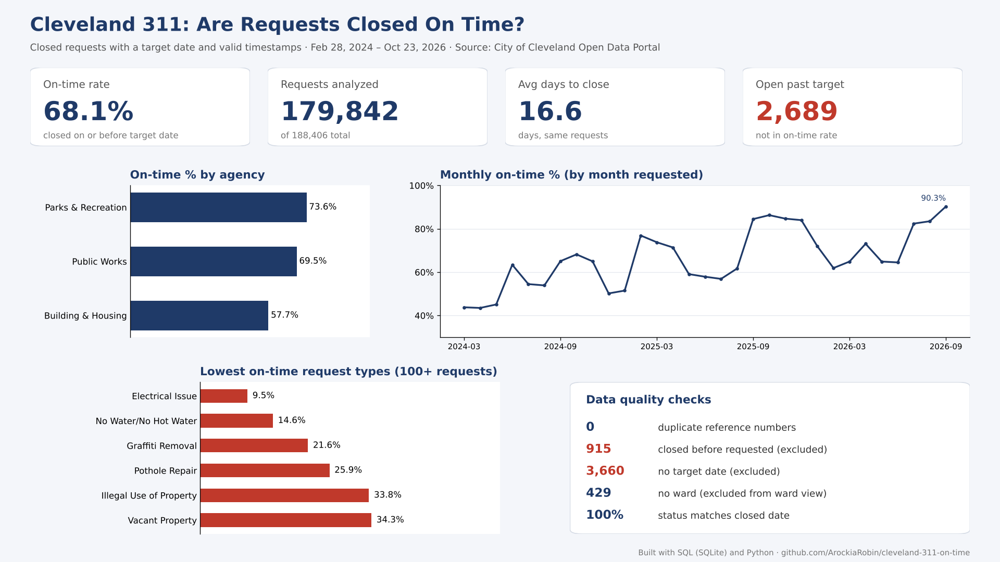

# Are Cleveland 311 Requests Closed On Time?

A small data-quality and performance review of the City of Cleveland's public 311 Service Requests data, built with SQL and Python.

**Author:** Arockia Robin Sebastin Leo · October 2026
**Data:** [City of Cleveland Open Data Portal: 311 Service Requests](https://data.clevelandohio.gov/datasets/311-service-requests/about), downloaded Oct 24, 2026 (188,406 requests, Feb 28, 2024 to Oct 23, 2026)

## Why this question

The [Mayor's Strategic Plan](https://www.clevelandohio.gov/mayor/strategic-plan/performance) lists **"% of 311 service requests closed on time"** as a City performance measure. The [public 311 dashboard](https://data.clevelandohio.gov/content/06ba73d626864512ae11fec43af467b7) shows request volume, status and location. This project uses the same open data to look at timeliness: how often requests are closed by their target date, and where that varies.



## Results

On time = closed on or before the target date. The rate uses **179,842** closed requests that have a target date and valid timestamps.

| Measure | Result |
|---|---|
| Overall on-time rate | **68.1%** |
| Jan–Sep trend | 53.2% (2024) → 65.6% (2025) → 73.6% (2026) |
| By agency | Parks & Recreation 73.6% · Public Works 69.5% · Building & Housing 57.7% |
| Highest-volume types | Missed Refuse Pick-up 98.0% (28,117) · Waste Cart Concerns 61.5% (47,330) · Illegal Dumping 44.5% (10,316) |
| Lower on-time types | Pothole Repair 25.9% (6,095) · Vacant Property 34.3% (8,187) |
| By 2026 ward | 64.5% (Ward 8) to 72.1% (Ward 1) |

## Data quality findings

| Check | Result |
|---|---|
| Rows after cleaning | 188,406 (no rows lost) |
| Duplicate reference numbers | 0 |
| Status vs. closed date | Consistent |
| Closed before requested | **915** (Public Works 567, Parks & Recreation 348). 739 came from inbound calls, about 2 hours apart, which suggests requests logged after the work was done. Excluded. |
| No target date | 3,660. On-time can't be judged. Excluded. |
| No ward | 429. Excluded from ward results only. |
| Open and already past target | 2,689. Not in the rate, which counts closed requests only. |

## Method

1. **Load:** imported the CSV as-is into SQLite (`raw_311`).
2. **Clean** (`sql/01_clean_311.sql`): renamed columns, trimmed text, turned blank text into NULLs, cast ward and coordinates to numbers, and converted US-format dates (`10/23/2026 11:55:19 PM`) to ISO (`2026-10-23 23:55:19`) so date math works.
3. **Validate** (`sql/02_data_checks.sql`): row counts, missing values, duplicates, impossible dates, status consistency.
4. **Analyze** (`sql/03_analysis.sql`): on-time rate overall and by agency, ward, request type and year.
5. **Prepare for BI** (`sql/04_bi_table.sql`): one table with `valid_for_sla`, `on_time` and `days_to_close` flags, so the business rule lives in one place and Power BI matches SQL.
6. **Visualize** (`python/dashboard.py`): one-page dashboard image (`images/dashboard.png`) drawn with matplotlib from the SQL results.

## Repository

```
sql/
  01_clean_311.sql     clean the raw import
  02_data_checks.sql   validation checks
  03_analysis.sql      on-time analysis
  04_bi_table.sql      final table for Power BI
docs/
  PROJECT_DOCUMENTATION.md / .pdf   full documentation
  311_on_time_summary.pdf           one-page summary
python/
  dashboard.py         builds the dashboard image
images/
  dashboard.png        dashboard
```

Full write-up, including design decisions, the main technical challenge and next steps: [docs/PROJECT_DOCUMENTATION.md](docs/PROJECT_DOCUMENTATION.md)

## How to run

1. Download the CSV from the link above.
2. In [DB Browser for SQLite](https://sqlitebrowser.org/), create a database and import the CSV as a table named `raw_311` (column names in first line).
3. Run the SQL files in order: `01_clean_311.sql`, `02_data_checks.sql`, `03_analysis.sql`, `04_bi_table.sql`.
4. Optional: `pip install matplotlib`, then `python python/dashboard.py` from the repository root to rebuild the dashboard image.

The raw CSV isn't included (64 MB).

## Limitations

- Uses public data only. The City's official on-time definition may differ, for example in how open, overdue requests are counted.
- Target dates come from the source system. The analysis doesn't judge whether targets are realistic for each request type.
- Recent months may shift as open requests close.

## Tools

SQLite (DB Browser for SQLite), SQL, Python (matplotlib). `04_bi_table.sql` prepares the data for Power BI.

---

*Code and documentation drafted with AI assistance; data loading, validation and analysis decisions by the author.*
